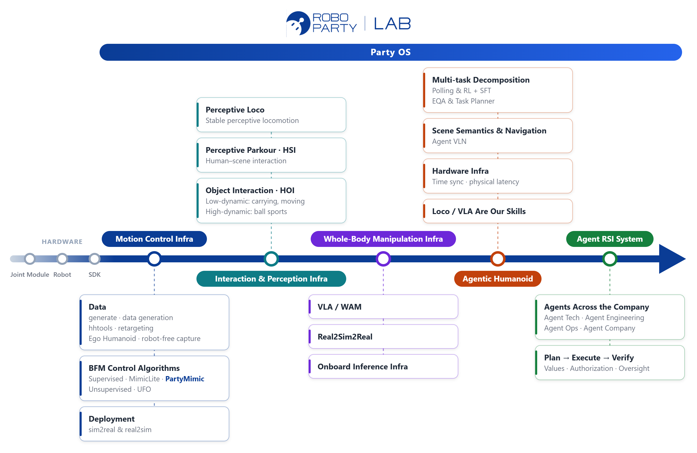

  

<h1 align="center">Party OS</h1>

  <strong>The ROBO PARTY LAB system stack for humanoid robots: from motion control to interaction, whole-body manipulation and agentic humanoids.</strong>

  <b>English</b> · <a href="README_zh.md">简体中文</a>

  
  
  

  <a href="#roadmap">🗺️ Roadmap</a> ·
  <a href="#projects">🧩 Projects</a> ·
  <a href="#datasets">📦 Datasets</a>

---

Party OS connects data collection and generation, motion retargeting, and supervised and unsupervised motion learning into a **motion control** layer. On top of it, the stack grows through **interaction and perception** (human–scene and human–object interaction), **whole-body manipulation** (VLA / world-action models), and finally **agentic humanoids**: a complete path from low-level tools to high-level interactive capabilities.

## 🗺️ Roadmap

  

The figure is generated by <a href="scripts/build_roadmap.py"><code>scripts/build_roadmap.py</code></a>; edit the text there and rerun to update both languages.

## 🧩 Projects

From low-level capabilities to high-level interaction, following the roadmap:

<table>
  <thead>
    <tr>
      <th width="16%">Layer</th>
      <th width="22%">Module</th>
      <th>Description</th>
      <th width="24%">Repository</th>
    </tr>
  </thead>
  <tbody>
    <tr>
      <td align="center">📚 <strong>Know-how</strong></td>
      <td>🧠 Knowledge base</td>
      <td>ROBO PARTY technical know-how and documentation</td>
      <td><a href="https://roboparty.feishu.cn/wiki/GvUxwKVeNiGa7kku6vEcvqfKn87">Humanoid Motion Control Know-how</a> (Chinese)</td>
    </tr>
    <tr>
      <td rowspan="5" align="center">🏃 <strong>Motion Control Infra</strong></td>
      <td>🏭 Data generation <code>generate</code></td>
      <td>Motion data generation</td>
      <td>🚧 Coming soon</td>
    </tr>
    <tr>
      <td>🔁 Retargeting <code>hhtools</code></td>
      <td>Fast retargeting of human or robot motion to any humanoid</td>
      <td><a href="https://github.com/Roboparty/human-humanoid-tools">Roboparty/human-humanoid-tools</a> </td>
    </tr>
    <tr>
      <td>🎯 Supervised learning <code>MimicLite</code></td>
      <td>Model-free motion tracking (PPO / PPO-ROA): loading, tracking, training, evaluation and deployment; real-robot teleoperation</td>
      <td><a href="https://github.com/Roboparty/MimicLite">Roboparty/MimicLite</a> </td>
    </tr>
    <tr>
      <td>⚡ Supervised learning <code>PartyMimic</code> </td>
      <td>Model-based motion tracking: one general tracker in 7–30 minutes on a single RTX 4090, lowest held-out error on G1 and RP1 · <a href="docs/mimiclite-vs-partymimic.md">vs MimicLite →</a></td>
      <td><a href="https://github.com/Roboparty/PartyMimic">Roboparty/PartyMimic</a> </td>
    </tr>
    <tr>
      <td>🛸 Unsupervised learning <code>UFO</code></td>
      <td>Unsupervised RL framework with FB / TeCH training, robot-aware motion import and real-world teleoperation</td>
      <td><a href="https://github.com/Roboparty/UFO">Roboparty/UFO</a> </td>
    </tr>
    <tr>
      <td rowspan="2" align="center">👀 <strong>Interaction &amp; Perception Infra</strong></td>
      <td>📦 Interaction BFM <code>I-BFM</code></td>
      <td>Humanoid interaction control with FB representations and LOGO: carrying, pushing and kicking boxes</td>
      <td><a href="https://github.com/Roboparty/I-BFM-Code">Roboparty/I-BFM-Code</a> </td>
    </tr>
    <tr>
      <td>⛰️ Perceptive BFM <code>P-BFM</code></td>
      <td>Terrain-adaptive humanoid control: motion tracking, goal reaching, reward inference and teleoperation</td>
      <td><a href="https://github.com/Roboparty/P-BFM">Roboparty/P-BFM</a> </td>
    </tr>
    <tr>
      <td align="center">🤲 <strong>Whole-Body Manipulation Infra</strong></td>
      <td>🌐 JEPA world model <code>INTACT-JEPA</code></td>
      <td>Efficient JEPA framework built on action-intent encoding</td>
      <td><a href="https://github.com/Roboparty/INTACT-JEPA">Roboparty/INTACT-JEPA</a> </td>
    </tr>
  </tbody>
</table>

📊 Choosing a motion tracker? See [MimicLite vs PartyMimic](docs/mimiclite-vs-partymimic.md).

## 📦 Datasets

Curated public datasets for each layer of the stack. Party OS does **not** redistribute any data: download from the upstream source, follow each dataset's license, and cite it when you publish.

🏃 <strong>Motion control</strong>: human motion, interaction and terrain motion for tracking policies (13)

 

Retargeting modes follow [hhtools](https://github.com/Roboparty/human-humanoid-tools/blob/main/docs/datasets.md): **mimic** flat-ground motion, **intermimic** human–object interaction, **meshmimic** terrain, **R2R** robot-to-robot.

| Dataset | Content | hhtools mode | Paper | Download | Used in Party OS |
|---|---|---|---|---|---|
| AMASS | Unified optical mocap (SMPL-X) | mimic | [📄&nbsp;arXiv](https://arxiv.org/abs/1904.03278) | [🌐&nbsp;site](https://amass.is.tue.mpg.de/) | |
| LAFAN1 | Mocap BVH: locomotion, dance, fall and get-up | mimic | [📄&nbsp;arXiv](https://arxiv.org/abs/2102.04942) | [💻&nbsp;GitHub](https://github.com/ubisoft/ubisoft-laforge-animation-dataset) | PartyMimic, MimicLite training |
| BONES-SEED (SOMA) | Large-scale mocap library | mimic | [📄&nbsp;arXiv](https://arxiv.org/abs/2603.16858) | [🤗&nbsp;HF](https://huggingface.co/datasets/bones-studio/seed) | PartyMimic, MimicLite training |
| 100STYLE | Stylized locomotion (Xsens BVH, 60 fps) | mimic | [📄&nbsp;ACM](https://dl.acm.org/doi/10.1145/3522618) | [🌐&nbsp;site](https://www.ianxmason.com/100style/) | MimicLite training (A3) |
| Motion-X | Whole-body motion extracted from video | mimic | [📄&nbsp;NeurIPS](https://proceedings.neurips.cc/paper_files/paper/2023/file/4f8e27f6036c1d8b4a66b5b3a947dd7b-Paper-Datasets_and_Benchmarks.pdf) | [💻&nbsp;GitHub](https://github.com/IDEA-Research/Motion-X) | |
| PHUMA | Physically grounded humanoid motion | mimic | [📄&nbsp;arXiv](https://arxiv.org/abs/2510.26236) | [💻&nbsp;GitHub](https://github.com/DAVIAN-Robotics/PHUMA) | |
| GVHMR | Monocular video → human motion (tool) | mimic | [📄&nbsp;arXiv](https://arxiv.org/abs/2409.06662) | [💻&nbsp;GitHub](https://github.com/zju3dv/GVHMR) | |
| OMOMO | Human–object interaction | intermimic | [📄&nbsp;arXiv](https://arxiv.org/abs/2309.16237) | [🤗&nbsp;HF](https://huggingface.co/datasets/YaojieShen/hhtools_omomo) | |
| OmniContact | Optical-mocap human–object interaction (90 Hz) | intermimic | [📄&nbsp;arXiv](https://arxiv.org/abs/2606.26201) | [🤗&nbsp;HF](https://huggingface.co/datasets/lightcone02/OmniContact-Dataset) | |
| holosoma | Terrain and parkour motion | meshmimic | [📄&nbsp;arXiv](https://arxiv.org/abs/2509.26633) | [💻&nbsp;GitHub](https://github.com/amazon-far/holosoma) | |
| PARC MS | Terrain and parkour motion | meshmimic | [📄&nbsp;arXiv](https://arxiv.org/abs/2505.04002) | [🤗&nbsp;HF](https://huggingface.co/datasets/YaojieShen/hhtools_parc_ms) | |
| MotionDecode | Unitree G1 robot trajectories (120 Hz) | R2R | [🌐&nbsp;site](https://chingmudata.github.io/MotionDecode/) | [🤗&nbsp;HF](https://huggingface.co/datasets/CMRobot/MotionDecode) | Held-out evaluation (sim2real leaderboard) |
| any4hdmi collection | Pre-converted MimicLite training sets | — | — | [🤗&nbsp;HF](https://huggingface.co/collections/elijahgalahad/any4hdmi) | MimicLite training |

🤲 <strong>Manipulation</strong>: robot teleoperation, humanoid, egocentric human and simulation data (19)

 

| Category | Dataset | Content | Paper | Download |
|---|---|---|---|---|
| 🦾 Cross-embodiment robot | Open X-Embodiment | 1M+ real-robot trajectories across 22 embodiments | [📄&nbsp;arXiv](https://arxiv.org/abs/2310.08864) | [🌐&nbsp;site](https://robotics-transformer-x.github.io/) |
| | DROID | In-the-wild Franka manipulation, 76k trajectories | [📄&nbsp;arXiv](https://arxiv.org/abs/2403.12945) | [🌐&nbsp;site](https://droid-dataset.github.io/) |
| | BridgeData V2 | WidowX manipulation across many environments | [📄&nbsp;arXiv](https://arxiv.org/abs/2308.12952) | [🌐&nbsp;site](https://rail-berkeley.github.io/bridgedata/) |
| | AgiBot World | Large-scale real-world dual-arm manipulation | [📄&nbsp;arXiv](https://arxiv.org/abs/2503.06669) | [🤗&nbsp;HF](https://huggingface.co/datasets/agibot-world/AgiBotWorld-Beta) |
| | RoboMIND | Multi-embodiment teleoperation, including a humanoid | [📄&nbsp;arXiv](https://arxiv.org/abs/2412.13877) | [🌐&nbsp;site](https://x-humanoid-robomind.github.io/) |
| | Galaxea Open-World | Mobile dual-arm manipulation in real homes and workplaces | [📄&nbsp;arXiv](https://arxiv.org/abs/2509.00576) | [🤗&nbsp;HF](https://huggingface.co/datasets/OpenGalaxea/Galaxea-Open-World-Dataset) |
| 🤖 Humanoid | Humanoid Everyday | Open-world humanoid manipulation | [📄&nbsp;arXiv](https://arxiv.org/abs/2510.08807) | [🌐&nbsp;site](https://humanoideveryday.github.io/) |
| | GR00T X-Embodiment Sim | Simulated humanoid and arm trajectories used by GR00T N1 | [📄&nbsp;arXiv](https://arxiv.org/abs/2503.14734) | [🤗&nbsp;HF](https://huggingface.co/datasets/nvidia/PhysicalAI-Robotics-GR00T-X-Embodiment-Sim) |
| | Unitree open datasets | G1 teleoperation with dexterous hands (LeRobot format) | — | [🤗&nbsp;HF](https://huggingface.co/unitreerobotics) |
| 👐 Egocentric human & hand–object | Ego4D | 3,000+ hours of egocentric video | [📄&nbsp;arXiv](https://arxiv.org/abs/2110.07058) | [🌐&nbsp;site](https://ego4d-data.org/) |
| | EgoDex | Large-scale egocentric dexterous manipulation with 3D hand tracking | [📄&nbsp;arXiv](https://arxiv.org/abs/2505.11709) | [💻&nbsp;GitHub](https://github.com/apple/ml-egodex) |
| | HOT3D | Egocentric multi-view 3D hand and object tracking | [📄&nbsp;arXiv](https://arxiv.org/abs/2411.19167) | [🌐&nbsp;site](https://facebookresearch.github.io/hot3d/) |
| | ARCTIC | Bimanual dexterous manipulation of articulated objects | [📄&nbsp;arXiv](https://arxiv.org/abs/2204.13662) | [🌐&nbsp;site](https://arctic.is.tue.mpg.de/) |
| | OakInk2 | Bimanual hand–object manipulation for complex tasks | [📄&nbsp;arXiv](https://arxiv.org/abs/2403.19417) | [🌐&nbsp;site](https://oakink.net/v2/) |
| | DexYCB | Hand grasping of YCB objects | [📄&nbsp;arXiv](https://arxiv.org/abs/2104.04631) | [🌐&nbsp;site](https://dex-ycb.github.io/) |
| | GigaHands | Large annotated dataset of bimanual hand activities | [📄&nbsp;arXiv](https://arxiv.org/abs/2412.04244) | [🌐&nbsp;site](https://ivl.cs.brown.edu/research/gigahands.html) |
| 🧪 Simulation benchmark | LIBERO | Lifelong-learning manipulation benchmark | [📄&nbsp;arXiv](https://arxiv.org/abs/2306.03310) | [🌐&nbsp;site](https://libero-project.github.io/) |
| | RoboCasa | Large-scale simulation of everyday household tasks | [📄&nbsp;arXiv](https://arxiv.org/abs/2406.02523) | [🌐&nbsp;site](https://robocasa.ai/) |
| | BEHAVIOR-1K | 1,000 everyday activities in realistic simulation | [📄&nbsp;arXiv](https://arxiv.org/abs/2403.09227) | [🌐&nbsp;site](https://behavior.stanford.edu/) |

Many of these are available in the [LeRobot](https://huggingface.co/lerobot) format, which is a convenient common format for training.

🧠 <strong>Agent</strong>: task planning, embodied QA, navigation and 3D scene understanding (14)

 

Grouped by the Agentic Humanoid items on the roadmap.

| Roadmap item | Dataset | Content | Paper | Download |
|---|---|---|---|---|
| 📋 Task planning & multi-task decomposition | ALFRED | Household instruction following in simulation | [📄&nbsp;arXiv](https://arxiv.org/abs/1912.01734) | [🌐&nbsp;site](https://askforalfred.com/) |
| | EgoPlan-Bench | Egocentric task planning for multimodal LLMs | [📄&nbsp;arXiv](https://arxiv.org/abs/2312.06722) | [💻&nbsp;GitHub](https://github.com/ChenYi99/EgoPlan) |
| | RoboVQA | Long-horizon multimodal reasoning for robots | [📄&nbsp;arXiv](https://arxiv.org/abs/2311.00899) | [🌐&nbsp;site](https://robovqa.github.io/) |
| | ShareRobot (RoboBrain) | Planning, affordance and trajectory annotations | [📄&nbsp;arXiv](https://arxiv.org/abs/2502.21257) | [🌐&nbsp;site](https://superrobobrain.github.io/) |
| | EmbodiedBench | Benchmark for vision-driven embodied MLLM agents | [📄&nbsp;arXiv](https://arxiv.org/abs/2502.09560) | [🌐&nbsp;site](https://embodiedbench.github.io/) |
| ❓ Embodied QA (EQA) | EQA | Embodied question answering in 3D houses | [📄&nbsp;arXiv](https://arxiv.org/abs/1711.11543) | [🌐&nbsp;site](https://embodiedqa.org/) |
| | OpenEQA | Open-vocabulary EQA from episodic memory and active exploration | CVPR 2024 | [🌐&nbsp;site](https://open-eqa.github.io/) |
| 🧭 Scene semantics & navigation (VLN) | R2R | Vision-and-language navigation in real buildings | [📄&nbsp;arXiv](https://arxiv.org/abs/1711.07280) | [🌐&nbsp;site](https://bringmeaspoon.org/) |
| | RxR | Multilingual VLN with dense grounding | [📄&nbsp;arXiv](https://arxiv.org/abs/2010.07954) | [💻&nbsp;GitHub](https://github.com/google-research-datasets/RxR) |
| | VLN-CE | VLN in continuous environments | [📄&nbsp;arXiv](https://arxiv.org/abs/2004.02857) | [🌐&nbsp;site](https://jacobkrantz.github.io/vlnce/) |
| | HM3D | 1,000 large-scale 3D environments for embodied AI | [📄&nbsp;arXiv](https://arxiv.org/abs/2109.08238) | [🌐&nbsp;site](https://aihabitat.org/datasets/hm3d/) |
| 🏠 3D scene understanding | ScanNet | Annotated 3D reconstructions of indoor scenes | [📄&nbsp;arXiv](https://arxiv.org/abs/1702.04405) | [🌐&nbsp;site](http://www.scan-net.org/) |
| | ScanQA | 3D question answering | [📄&nbsp;arXiv](https://arxiv.org/abs/2112.10482) | [💻&nbsp;GitHub](https://github.com/ATR-DBI/ScanQA) |
| | SQA3D | Situated question answering in 3D scenes | [📄&nbsp;arXiv](https://arxiv.org/abs/2210.07474) | [🌐&nbsp;site](https://sqa3d.github.io/) |

## 📜 License

This repository is licensed under the [GNU General Public License v3.0 (GPL-3.0)](LICENSE). Each sub-project keeps its own license; check the corresponding repository before use. Datasets listed above are subject to their own licenses.
