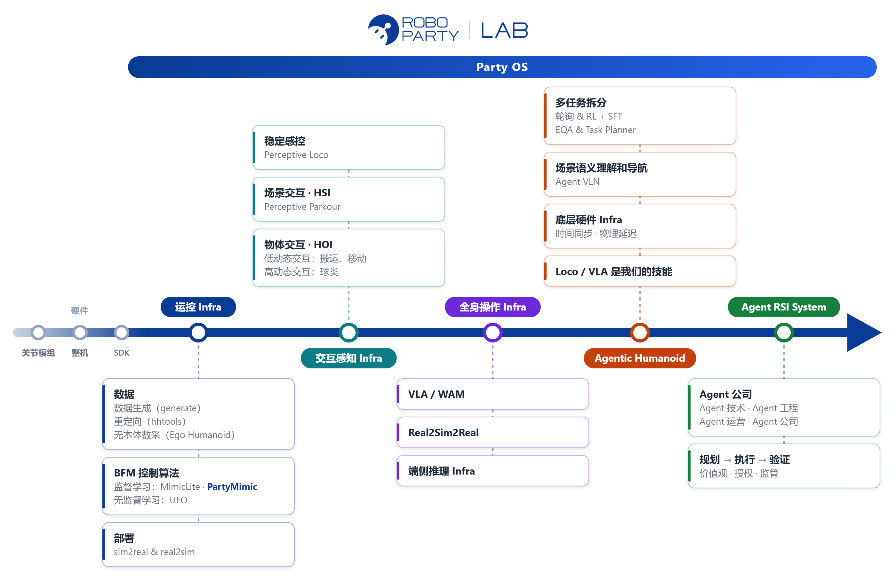

  

<h1 align="center">Party OS</h1>

  <strong>ROBO PARTY LAB 面向人形机器人的系统栈： 从运控出发，逐步走向交互感知、全身操作与 Agentic Humanoid。</strong>

  <a href="README.md">English</a> · <b>简体中文</b>

  
  
  

  <a href="#路线图">路线图</a> ·
  <a href="#子项目">子项目</a> ·
  <a href="#mimiclite-与-partymimic">MimicLite 与 PartyMimic</a> ·
  <a href="#数据集">数据集</a> ·
  <a href="#许可证">许可证</a>

---

Party OS 把数据采集与生成、动作重定向、监督学习与无监督学习串成**运控**层；在此之上依次扩展到**交互感知**（人–场景交互 HSI、人–物交互 HOI）、**全身操作**（VLA / WAM），最终走向 **Agentic Humanoid**，形成从底层工具到上层交互能力的完整栈。

## 路线图

  

路线图由 <a href="scripts/build_roadmap.py"><code>scripts/build_roadmap.py</code></a> 生成，修改其中的文字后重新运行即可同时更新中英文两版。

## 子项目

按路线图从底层能力到上层交互展开：

<table>
  <thead>
    <tr>
      <th width="18%">层级</th>
      <th width="22%">模块</th>
      <th>说明</th>
      <th width="24%">仓库</th>
    </tr>
  </thead>
  <tbody>
    <tr>
      <td><strong>Know-how 文档</strong></td>
      <td>知识库</td>
      <td>ROBO PARTY 技术 Know-how 与文档汇总</td>
      <td><a href="https://roboparty.feishu.cn/wiki/GvUxwKVeNiGa7kku6vEcvqfKn87">《人形机器人运动控制 Know-how》</a></td>
    </tr>
    <tr>
      <td rowspan="5"><strong>运控 Infra</strong></td>
      <td>数据生成 (generate)</td>
      <td>动作数据生成</td>
      <td>即将开源</td>
    </tr>
    <tr>
      <td>重定向 (hhtools)</td>
      <td>人体 / 机器人动作到任意人形的快速重定向</td>
      <td><a href="https://github.com/Roboparty/human-humanoid-tools">Roboparty/human-humanoid-tools</a></td>
    </tr>
    <tr>
      <td>监督学习 (MimicLite)</td>
      <td>无模型运动跟踪（PPO / PPO-ROA）：加载、跟踪、训练、评估与部署衔接，支持真机遥操作</td>
      <td><a href="https://github.com/Roboparty/MimicLite">Roboparty/MimicLite</a></td>
    </tr>
    <tr>
      <td>监督学习 (PartyMimic) </td>
      <td>基于模型的运动跟踪：单张 RTX 4090 上 7–30 分钟训练出通用跟踪器，G1 和 RP1 上 held-out 误差最低（<a href="#mimiclite-与-partymimic">对比</a>）</td>
      <td><a href="https://github.com/Roboparty/PartyMimic">Roboparty/PartyMimic</a></td>
    </tr>
    <tr>
      <td>无监督学习 (UFO)</td>
      <td>无监督强化学习框架：FB / TeCH 训练、面向机器人的动作导入与真机遥操作</td>
      <td><a href="https://github.com/Roboparty/UFO">Roboparty/UFO</a></td>
    </tr>
    <tr>
      <td rowspan="2"><strong>交互感知 Infra</strong></td>
      <td>交互基础模型 (I-BFM)</td>
      <td>基于 FB 表征与 LOGO 的人形机器人交互控制，支持搬箱、推箱和踢箱</td>
      <td><a href="https://github.com/Roboparty/I-BFM-Code">Roboparty/I-BFM-Code</a></td>
    </tr>
    <tr>
      <td>感知行为基础模型 (P-BFM)</td>
      <td>面向地形自适应的人形控制，支持运动跟踪、目标到达、奖励推理与遥操作</td>
      <td><a href="https://github.com/Roboparty/P-BFM">Roboparty/P-BFM</a></td>
    </tr>
    <tr>
      <td><strong>全身操作 Infra</strong></td>
      <td>JEPA World Model</td>
      <td>基于动作意图编码的高效 JEPA 框架</td>
      <td><a href="https://github.com/Roboparty/INTACT-JEPA">Roboparty/INTACT-JEPA</a></td>
    </tr>
  </tbody>
</table>

## MimicLite 与 PartyMimic

两者都是运控层的通用运动跟踪器，解决同一个问题，但学习范式不同，定位互补：**MimicLite 是部署基线，PartyMimic 是快速迭代的引擎。**

| | [MimicLite](https://github.com/Roboparty/MimicLite) | [PartyMimic](https://github.com/Roboparty/PartyMimic) |
|---|---|---|
| 学习范式 | **无模型强化学习**：PPO，加上 PPO-ROA 师生适应（Train → Adapt → Finetune） | **基于模型**（SuperMimic 系列）：在线学习一个 MLP 世界模型，策略通过 32 步想象展开反向传播训练，horizon 之外由 critic 接管 |
| 训练算力 | 8 × 8,192 个并行环境；G1 v1.1 约 50 GPU 小时 | 单张 RTX 4090（峰值 22 GB），**7–30 分钟**；可选双卡流水线 |
| Held-out 误差，G1 Loc/Man ¹ | 26.7 mm | **23.6 mm**（12k 迭代） |
| 参考前瞻 | **0.08 s** | 0.20 s（50 Hz 下未来 10 帧） |
| 支持机器人 | 已发布 G1、H2、A3、RP1（28 / 24 自由度）的 checkpoint | G1、RP1（28 自由度） |
| 仿真 | [active-adaptation](https://github.com/Agent-3154/active-adaptation) 训练框架 | [mjlab](https://github.com/mujocolab/mjlab) + MuJoCo Warp |
| 验证 | G1 真机：Pico 遥操作、高动态动作跟踪 | 按 [sim2real leaderboard](https://egalahad.github.io/sim2real/leaderboard/) 协议做 sim2sim；导出 ONNX 和部署 YAML，接入同一套部署运行时 |
| 适合做什么 | 真机部署、低延迟遥操作 | 新机器人、新数据，以及奖励、接口、约束等实验，几十分钟出结果 |

¹ 在 held-out 的 MotionDecode 划分上，用 sim2real leaderboard 的 sim2sim 评测器计算的身体位置误差。MimicLite 的数字是其官方 leaderboard 结果，训练数据和硬件与 PartyMimic 不同；完整协议见 <a href="https://github.com/Roboparty/PartyMimic#results-on-held-out-motions">PartyMimic README</a>。

## 数据集

按系统栈的层级整理的公开数据集。Party OS **不重新分发任何数据**：请从上游下载，遵守各数据集的许可证，发表成果时请引用对应数据集。

<strong>运控</strong>：用于跟踪策略的人体动作、交互动作与地形动作（13）

 

重定向模式与 [hhtools](https://github.com/Roboparty/human-humanoid-tools/blob/main/docs/datasets_cn.md) 一致：**mimic** 为平地动作，**intermimic** 为人–物交互，**meshmimic** 为地形，**R2R** 为机器人到机器人。

| 数据集 | 内容 | hhtools 模式 | 论文 | 下载 | 在 Party OS 中的用途 |
|---|---|---|---|---|---|
| AMASS | 统一格式的光学动捕（SMPL-X） | mimic | [arXiv](https://arxiv.org/abs/1904.03278) | [官网](https://amass.is.tue.mpg.de/) | |
| LAFAN1 | 动捕 BVH：行走、舞蹈、摔倒与起身 | mimic | [arXiv](https://arxiv.org/abs/2102.04942) | [GitHub](https://github.com/ubisoft/ubisoft-laforge-animation-dataset) | PartyMimic、MimicLite 训练 |
| BONES-SEED (SOMA) | 大规模动捕动作库 | mimic | [arXiv](https://arxiv.org/abs/2603.16858) | [Hugging Face](https://huggingface.co/datasets/bones-studio/seed) | PartyMimic、MimicLite 训练 |
| 100STYLE | 风格化行走（Xsens BVH，60 fps） | mimic | [ACM](https://dl.acm.org/doi/10.1145/3522618) | [官网](https://www.ianxmason.com/100style/) | MimicLite 训练（A3） |
| Motion-X | 从视频提取的全身动作 | mimic | [NeurIPS](https://proceedings.neurips.cc/paper_files/paper/2023/file/4f8e27f6036c1d8b4a66b5b3a947dd7b-Paper-Datasets_and_Benchmarks.pdf) | [GitHub](https://github.com/IDEA-Research/Motion-X) | |
| PHUMA | 物理可行的人形动作 | mimic | [arXiv](https://arxiv.org/abs/2510.26236) | [GitHub](https://github.com/DAVIAN-Robotics/PHUMA) | |
| GVHMR | 单目视频 → 人体动作（工具） | mimic | [arXiv](https://arxiv.org/abs/2409.06662) | [GitHub](https://github.com/zju3dv/GVHMR) | |
| OMOMO | 人–物交互 | intermimic | [arXiv](https://arxiv.org/abs/2309.16237) | [Hugging Face](https://huggingface.co/datasets/YaojieShen/hhtools_omomo) | |
| OmniContact | 光学动捕人–物交互（90 Hz） | intermimic | [arXiv](https://arxiv.org/abs/2606.26201) | [Hugging Face](https://huggingface.co/datasets/lightcone02/OmniContact-Dataset) | |
| holosoma | 地形与跑酷动作 | meshmimic | [arXiv](https://arxiv.org/abs/2509.26633) | [GitHub](https://github.com/amazon-far/holosoma) | |
| PARC MS | 地形与跑酷动作 | meshmimic | [arXiv](https://arxiv.org/abs/2505.04002) | [Hugging Face](https://huggingface.co/datasets/YaojieShen/hhtools_parc_ms) | |
| MotionDecode | Unitree G1 机器人轨迹（120 Hz） | R2R | [官网](https://chingmudata.github.io/MotionDecode/) | [Hugging Face](https://huggingface.co/datasets/CMRobot/MotionDecode) | Held-out 评测（sim2real leaderboard） |
| any4hdmi 合集 | MimicLite 预转换的训练集 | — | — | [Hugging Face](https://huggingface.co/collections/elijahgalahad/any4hdmi) | MimicLite 训练 |

<strong>操作</strong>：机器人遥操作、人形、第一视角人类与仿真数据（19）

 

| 类别 | 数据集 | 内容 | 论文 | 下载 |
|---|---|---|---|---|
| 跨本体机器人 | Open X-Embodiment | 22 种本体、100 万条以上真机轨迹 | [arXiv](https://arxiv.org/abs/2310.08864) | [官网](https://robotics-transformer-x.github.io/) |
| | DROID | 真实场景 Franka 操作，7.6 万条轨迹 | [arXiv](https://arxiv.org/abs/2403.12945) | [官网](https://droid-dataset.github.io/) |
| | BridgeData V2 | 多环境 WidowX 操作 | [arXiv](https://arxiv.org/abs/2308.12952) | [官网](https://rail-berkeley.github.io/bridgedata/) |
| | AgiBot World | 大规模真实世界双臂操作 | [arXiv](https://arxiv.org/abs/2503.06669) | [Hugging Face](https://huggingface.co/datasets/agibot-world/AgiBotWorld-Beta) |
| | RoboMIND | 多本体遥操作，包含人形 | [arXiv](https://arxiv.org/abs/2412.13877) | [官网](https://x-humanoid-robomind.github.io/) |
| | Galaxea Open-World | 真实家庭与工作场所中的移动双臂操作 | [arXiv](https://arxiv.org/abs/2509.00576) | [Hugging Face](https://huggingface.co/datasets/OpenGalaxea/Galaxea-Open-World-Dataset) |
| 人形 | Humanoid Everyday | 开放世界人形操作 | [arXiv](https://arxiv.org/abs/2510.08807) | [官网](https://humanoideveryday.github.io/) |
| | GR00T X-Embodiment Sim | GR00T N1 使用的人形与机械臂仿真轨迹 | [arXiv](https://arxiv.org/abs/2503.14734) | [Hugging Face](https://huggingface.co/datasets/nvidia/PhysicalAI-Robotics-GR00T-X-Embodiment-Sim) |
| | Unitree 开源数据集 | G1 + 灵巧手遥操作（LeRobot 格式） | — | [Hugging Face](https://huggingface.co/unitreerobotics) |
| 第一视角人类与手–物交互 | Ego4D | 3,000 小时以上第一视角视频 | [arXiv](https://arxiv.org/abs/2110.07058) | [官网](https://ego4d-data.org/) |
| | EgoDex | 大规模第一视角灵巧操作，带 3D 手部跟踪 | [arXiv](https://arxiv.org/abs/2505.11709) | [GitHub](https://github.com/apple/ml-egodex) |
| | HOT3D | 第一视角多视图 3D 手与物体跟踪 | [arXiv](https://arxiv.org/abs/2411.19167) | [官网](https://facebookresearch.github.io/hot3d/) |
| | ARCTIC | 铰接物体的双手灵巧操作 | [arXiv](https://arxiv.org/abs/2204.13662) | [官网](https://arctic.is.tue.mpg.de/) |
| | OakInk2 | 面向复杂任务的双手–物体操作 | [arXiv](https://arxiv.org/abs/2403.19417) | [官网](https://oakink.net/v2/) |
| | DexYCB | YCB 物体的手部抓取 | [arXiv](https://arxiv.org/abs/2104.04631) | [官网](https://dex-ycb.github.io/) |
| | GigaHands | 大规模标注的双手活动数据 | [arXiv](https://arxiv.org/abs/2412.04244) | [官网](https://ivl.cs.brown.edu/research/gigahands.html) |
| 仿真基准 | LIBERO | 终身学习操作基准 | [arXiv](https://arxiv.org/abs/2306.03310) | [官网](https://libero-project.github.io/) |
| | RoboCasa | 大规模日常家务仿真 | [arXiv](https://arxiv.org/abs/2406.02523) | [官网](https://robocasa.ai/) |
| | BEHAVIOR-1K | 逼真仿真中的 1,000 项日常活动 | [arXiv](https://arxiv.org/abs/2403.09227) | [官网](https://behavior.stanford.edu/) |

其中很多数据集提供 [LeRobot](https://huggingface.co/lerobot) 格式，可以作为训练时的统一格式。

<strong>Agent</strong>：任务规划、具身问答、导航与 3D 场景理解（14）

 

按路线图中 Agentic Humanoid 的条目分组。

| 路线图条目 | 数据集 | 内容 | 论文 | 下载 |
|---|---|---|---|---|
| 任务规划与多任务拆分 | ALFRED | 仿真家庭环境中的指令跟随 | [arXiv](https://arxiv.org/abs/1912.01734) | [官网](https://askforalfred.com/) |
| | EgoPlan-Bench | 面向多模态大模型的第一视角任务规划 | [arXiv](https://arxiv.org/abs/2312.06722) | [GitHub](https://github.com/ChenYi99/EgoPlan) |
| | RoboVQA | 机器人长程多模态推理 | [arXiv](https://arxiv.org/abs/2311.00899) | [官网](https://robovqa.github.io/) |
| | ShareRobot (RoboBrain) | 规划、可供性与轨迹标注 | [arXiv](https://arxiv.org/abs/2502.21257) | [官网](https://superrobobrain.github.io/) |
| | EmbodiedBench | 视觉驱动的具身多模态大模型智能体基准 | [arXiv](https://arxiv.org/abs/2502.09560) | [官网](https://embodiedbench.github.io/) |
| 具身问答（EQA） | EQA | 3D 房屋中的具身问答 | [arXiv](https://arxiv.org/abs/1711.11543) | [官网](https://embodiedqa.org/) |
| | OpenEQA | 基于情景记忆与主动探索的开放词汇 EQA | CVPR 2024 | [官网](https://open-eqa.github.io/) |
| 场景语义理解与导航（VLN） | R2R | 真实建筑中的视觉–语言导航 | [arXiv](https://arxiv.org/abs/1711.07280) | [官网](https://bringmeaspoon.org/) |
| | RxR | 多语言、细粒度对齐的 VLN | [arXiv](https://arxiv.org/abs/2010.07954) | [GitHub](https://github.com/google-research-datasets/RxR) |
| | VLN-CE | 连续环境中的 VLN | [arXiv](https://arxiv.org/abs/2004.02857) | [官网](https://jacobkrantz.github.io/vlnce/) |
| | HM3D | 1,000 个面向具身智能的大规模 3D 场景 | [arXiv](https://arxiv.org/abs/2109.08238) | [官网](https://aihabitat.org/datasets/hm3d/) |
| 3D 场景理解 | ScanNet | 带标注的室内场景 3D 重建 | [arXiv](https://arxiv.org/abs/1702.04405) | [官网](http://www.scan-net.org/) |
| | ScanQA | 3D 问答 | [arXiv](https://arxiv.org/abs/2112.10482) | [GitHub](https://github.com/ATR-DBI/ScanQA) |
| | SQA3D | 3D 场景中的情境问答 | [arXiv](https://arxiv.org/abs/2210.07474) | [官网](https://sqa3d.github.io/) |

## 许可证

本仓库采用 [GNU General Public License v3.0 (GPL-3.0)](LICENSE)。各子项目保留各自的许可证，使用前请查阅对应仓库说明。上面列出的数据集遵循各自的许可证。
